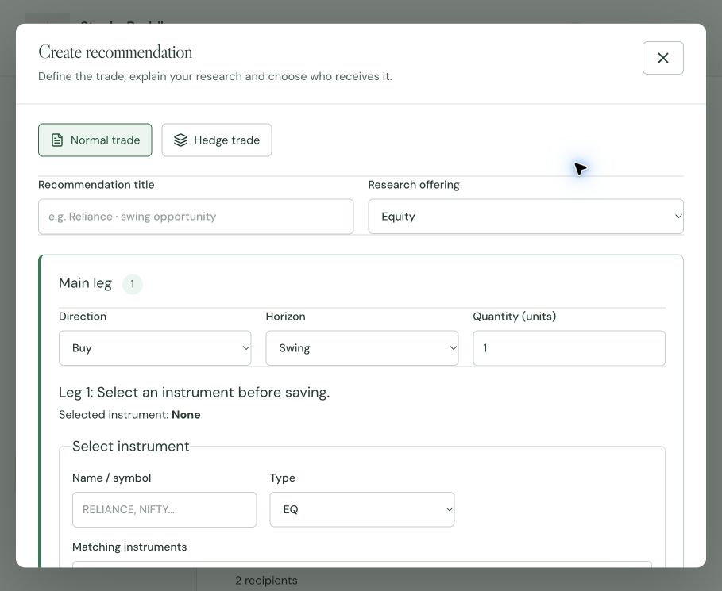
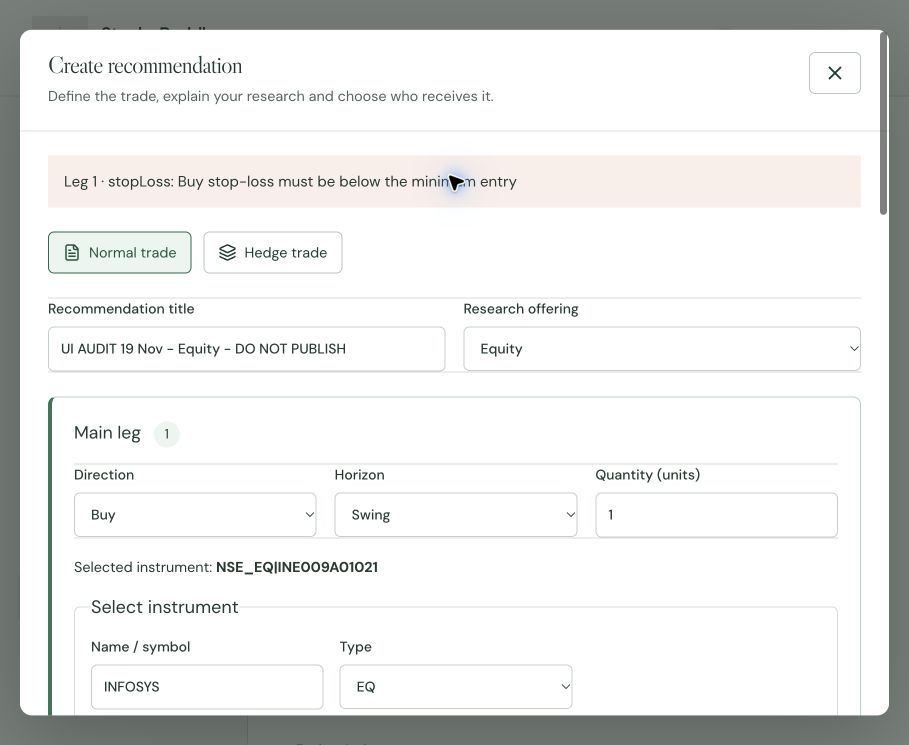
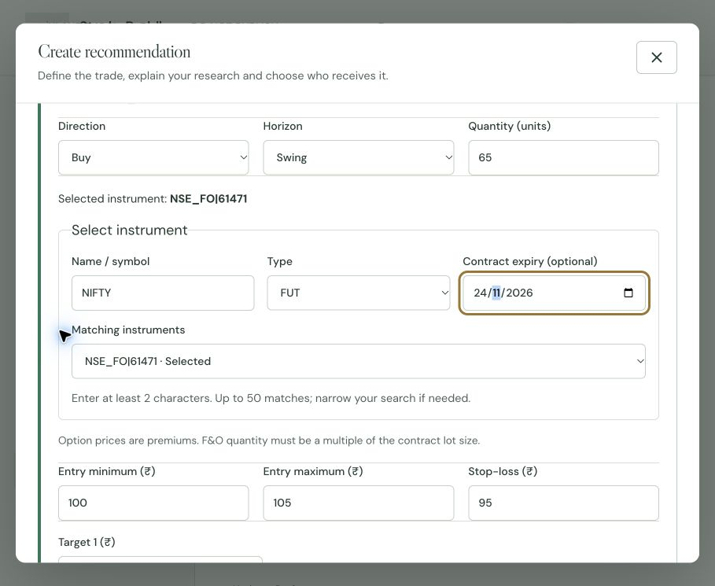
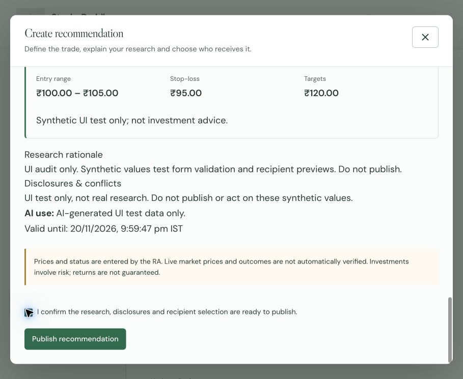
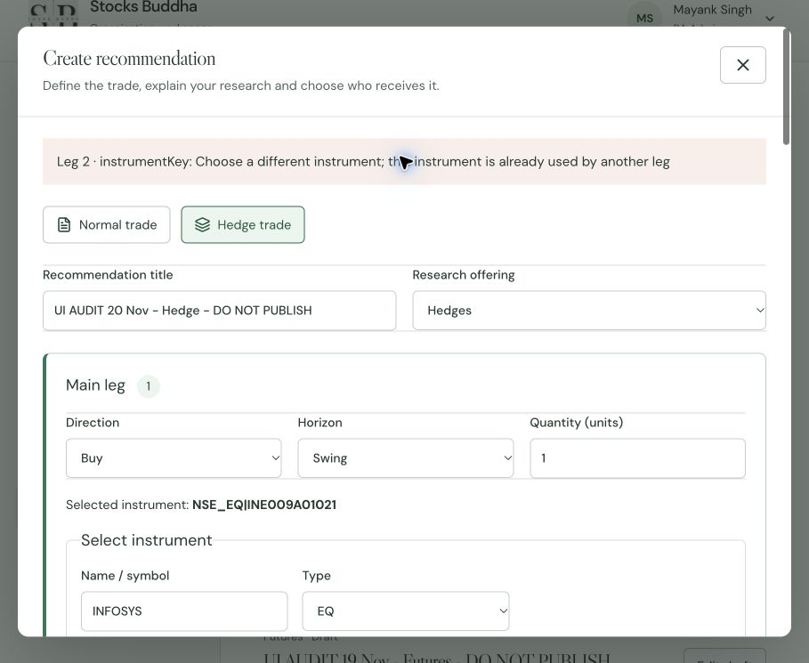
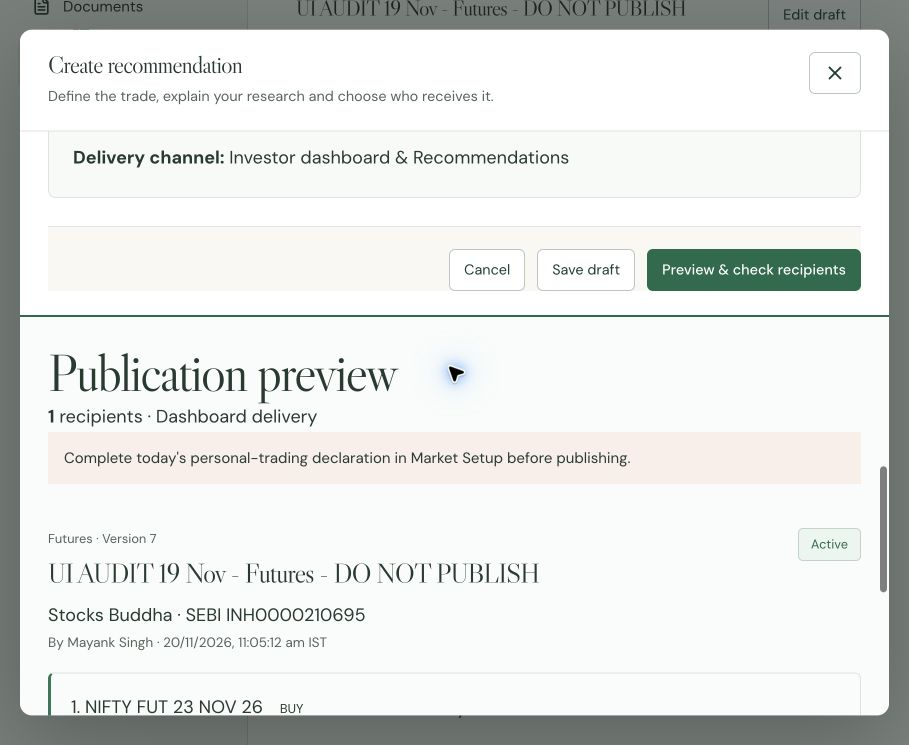
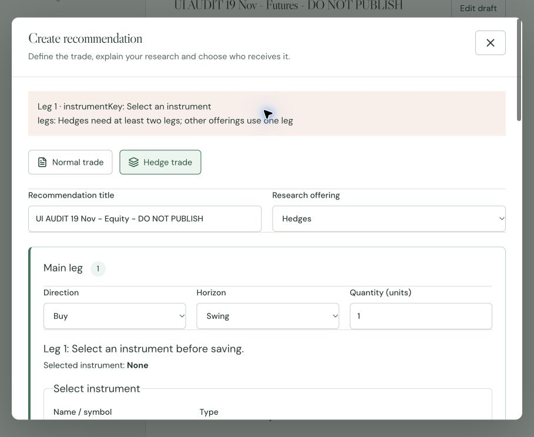
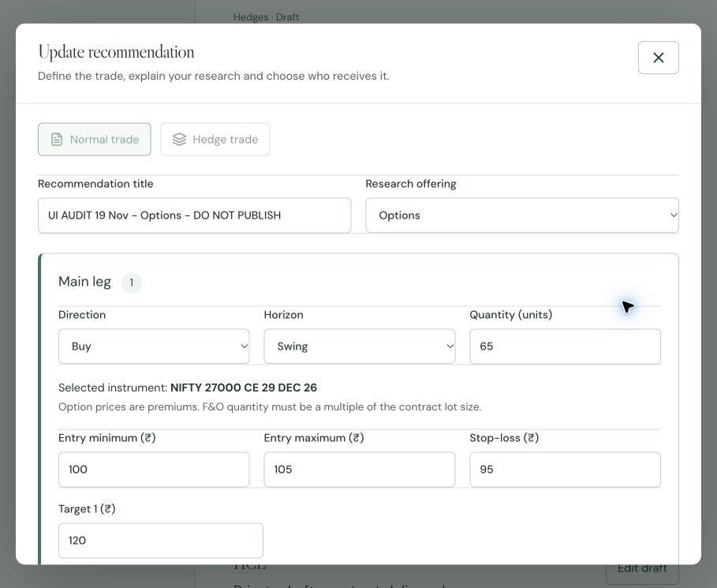

# Recommendations: live UI audit

**Tested:** 19–20 November 2026, IST. **Surface:** logged-in RA Admin at `http://localhost:3000/ra/stocksbuddha/workspace/recommendations?lang=en`. **Completed:** 20 November 2026.

> Historical baseline. Subsequent fixes and verification are recorded in [RETEST.md](RETEST.md).

## Verdict

The recommendation workflow is partly working, with reproducible UI defects and several correctly enforced publication restrictions. Complete Equity, Futures, Options and mixed Equity/put-option test records could be saved through the UI. Futures previews correctly distinguished Gold from Silver and intersected a client group with existing entitlement. This is not a blanket end-to-end delivery certification: I did not click Publish, submit a trading declaration, withdraw a report, or log in as an investor.

The most significant confirmed workflow defect is that the two ways of selecting a hedge produce different forms. There are also silent loss of unsaved edits, off-screen feedback, internal instrument IDs, and incomplete empty-state explanations.

## How the flow works, and what passed

| Step | Operation                          | Observed behavior                                                                                                                                                                                                                                         | Health                                                                                         |
| ---- | ---------------------------------- | --------------------------------------------------------------------------------------------------------------------------------------------------------------------------------------------------------------------------------------------------------- | ---------------------------------------------------------------------------------------------- |
| 1    | Open Recommendations               | Lists drafts separately from active reports. Drafts say “Private draft — not yet delivered”; active records show version and recipient count.                                                                                                             | Working                                                                                        |
| 2    | Create normal Equity               | Equity restricts instrument Type to EQ. No contract-expiry field is shown. INFOSYS search found INFY; selecting it and completing all required values saved successfully.                                                                                 | Working                                                                                        |
| 3    | Search or reopen                   | Changing search from INFOSYS to RELIANCE preserved the previously selected INFY identity. Closing and reopening retained saved prices and instrument identity, but displayed the raw instrument key.                                                      | Functional, poor identification                                                                |
| 4    | Validate prices                    | Buy stop-loss 110 with entry 100–105 was rejected with “Leg 1 · stopLoss: Buy stop-loss must be below the minimum entry.” The earlier valid saved data remained intact.                                                                                   | Working validation; error placement needs improvement                                          |
| 5    | Preview Equity                     | All-eligible preview showed zero recipients and disabled Publish. The UI explains that no selected subscribers qualify for this offering, but gives no individual exclusion reasons.                                                                      | Correct restriction, limited diagnosis                                                         |
| 6    | Create Futures                     | FUT-only search returned NIFTY contracts. Selecting NIFTY FUT 23 NOV 26 set quantity to 65. A complete test draft saved.                                                                                                                                  | Working                                                                                        |
| 7    | Filter expiry                      | After committing the native date input to 24 November, search had no matching contracts; the already selected 23 November contract remained selected. The filter is a search criterion, not a new expiry for the selected instrument.                     | Preservation works; mismatch is confusing                                                      |
| 8    | Validate derivative quantity/dates | Quantity 1 was blocked at preview; 65 passed. Recommendation validity of 25 November was blocked for a contract expiring 23 November.                                                                                                                     | Working publication guards                                                                     |
| 9    | Target plans                       | Futures with Gold selected produced two recipients. Selecting Silver instead produced zero. With valid values on 19 November, confirming the readiness checkbox enabled Publish; it was not clicked.                                                      | Working for observed local investors                                                           |
| 10   | Options                            | CE search returned actual option contracts. NIFTY 27000 CE 29 DEC 26 was selected and preview requested. On resumption the record was already Active with two recipients; its report rendered quantity, strike, expiry, prices and disclosures correctly. | Creation/report viewing working; final publication was not performed or observed by this audit |
| 11   | Hedge button                       | “Hedge trade” created two legs. A duplicate INFY instrument was rejected on leg 2. A mixed INFY Equity/NIFTY PE draft then saved and previewed. Adding/removing a third leg worked.                                                                       | Working via button                                                                             |
| 12   | Attach existing document           | Existing RA file selection persisted in the hedge draft and appeared in preview under Supporting documents.                                                                                                                                               | Selection/persistence working; upload/download not tested                                      |
| 13   | Groups                             | Created a clearly named one-investor test group and reopened it. Futures targeting that group produced one recipient; the same group targeting Hedges produced zero. Group membership did not grant hedge access.                                         | Working                                                                                        |
| 14   | Daily declaration                  | On 20 November the reminder appeared and preview blocked publishing with “Complete today's personal-trading declaration…” while still showing eligible recipient counts.                                                                                  | Working date-dependent restriction                                                             |
| 15   | Published report/update controls   | Report and publication-history selector rendered. Prepare update locked category, direction, instruments and audience, with an explicit original-recipient explanation.                                                                                   | Read/control checks pass; update/closure submission not tested                                 |

**Interpretation:** saving a draft does not deliver it. Preview first saves the current draft, then checks eligibility and publication restrictions. Only a subsequent confirmed publication delivers the report. A valid form can still have zero recipients. A nonzero recipient count can still be blocked by declaration, lot-size or expiry checks.

## Confirmed defects and recommended repairs

### 1. High priority: inconsistent hedge-mode entry

**Reproduction:** Open a one-leg Equity draft → Research offering → Hedges → Save draft.

**Actual:** The form switches to Hedges, disables the category selector and clears the selected instrument, but still has just one leg. Save reports a missing instrument and “Hedges need at least two legs.” In contrast, clicking the separate Hedge trade button creates a second leg.

**Fix:** One shared category-transition function. Both entry points should create the required leg structure and preserve compatible selections. Test both paths, not just the button. Evidence: screenshot 21.

### 2. High priority: unsaved edits are discarded without warning

**Reproduction:** Reopen the audit Equity draft → change title to `UNSAVED UI AUDIT CHANGE` → click Close editor.

**Actual:** Modal closes immediately; no confirmation appears; list retains the old saved title. Escape also dismissed the editor while interacting with its picker. There is no demonstrated draft recovery.

**Fix:** Track dirty state; intercept Close, Cancel, Escape and outside dismissal with a clear save/discard choice. Do not describe incomplete forms as safely saved.

### 3. Medium priority: save/error feedback is off-screen

Save and Preview actions are at the bottom of a long scrolling modal. Success status and schema errors appear at its top. After Save, the screenshot at the action position showed no success feedback. Error text becomes visible only after scrolling to it. The button also says “Saving…” during preview work.

**Fix:** Put status near the action; focus or scroll to an error summary; attach field errors to the inputs; use distinct save/preview progress labels. Evidence: screenshots 03 and 05.

### 4. Medium priority: saved instruments become opaque IDs

Reopened INFY displayed `NSE_EQ|INE009A01021 · Selected` with an empty search box. HCL showed the same problem with its own key. Published update view, in contrast, displayed the human-readable contract name.

**Fix:** Resolve selected keys to a label when opening a draft. Always show exchange, symbol, type and, for derivatives, expiry/strike/lot size. Evidence: screenshot 06.

### 5. Medium priority: retained selection can disagree with search filters without explanation

A 24 November expiry filter retained the already selected 23 November Futures contract. Switching a hedge leg's search Type from EQ to PE likewise retained the Equity choice until a replacement was chosen. Preservation is useful, but the selected item sits under “Matching instruments,” even though it does not match the filters. No “No matches” explanation appears.

**Fix:** Separate the selected-instrument summary from search results; show “No instruments match these filters; your previous selection is unchanged.” Do not silently remove a valid selection. Evidence: screenshot 09.

### 6. Medium priority: empty client-group selector is a dead end

Before any group existed, “Specific client groups” displayed no choices and no explanation or create-group link. Save then rejected it with “Choose at least one plan or group.”

**Fix:** Display an empty state with a create-group action, or disable that audience mode until a group exists. Evidence: screenshot 18.

### 7. Medium priority: preview looks published

An unpublished or blocked preview displays an **Active** badge and a “By [author] · [timestamp]” line. It looks like a delivered report despite zero recipients or a declaration blocker.

**Fix:** Clearly label “Unpublished preview.” Distinguish proposed version/time from actual publication metadata. Evidence: screenshots 04, 12 and 17.

### 8. Lower priority: presentation and diagnostic gaps

- Existing drafts open with the heading “Create recommendation,” not “Edit draft.”
- Errors expose code field names such as `instrumentKey` and `stopLoss` instead of friendly labels.
- Equity legs still display the F&O premium/lot-size helper text.
- View research and Client groups append content below the list; it can appear that clicking did nothing until scrolling down.
- At the observed browser width, the Active badge wrapped as “Activ” / “e” beside a long title.
- Recipient preview gives counts, not an auditable recipient/exclusion breakdown.

## Environment incident, not a confirmed routing defect

On resumption, View research returned “Failed to fetch.” The local process check found no server listening on port 3000. Restarting `npm run dev` and reloading restored the logged-in page and report viewing. This incident should not be attributed to recipient selection. Evidence: screenshot 14.

## State left behind

The following clearly labelled test records exist:

- `UI AUDIT 19 Nov - Equity - DO NOT PUBLISH`: private draft, saved valid Equity values; the unsaved hedge-dropdown experiment was rejected and discarded.
- `UI AUDIT 19 Nov - Futures - DO NOT PUBLISH`: private draft, quantity 65, last saved targeting the one-investor audit group.
- `UI AUDIT 19 Nov - Options - DO NOT PUBLISH`: **Active, two recipients** on resumption. My last action before the pause was clicking Preview & check recipients. I did not click Publish and cannot attribute the intervening publication. The published record was left unchanged.
- `UI AUDIT 20 Nov - Hedge - DO NOT PUBLISH`: private mixed Equity/PE draft, last saved targeting the audit group; existing RA PDF attached.
- `UI AUDIT 20 Nov - one investor`: saved group with one existing investor selected.

Original HCL, Infosys, NIFTY and Reliance records were not edited by this audit. HCL was opened read-only. No test records were deleted. The local development server was restarted. No application source fixes were made during this audit.

## Limits

No investor-login delivery/read/download test; no final Publish, update, withdrawal or closure submission; no new upload or file-size/MIME boundary test; no broad mobile, Hindi or screen-reader certification. The audit confirms the observed admin workflow and recipient counts, not every underlying eligibility branch. Silver/Platinum positive delivery could not be demonstrated with the current observed audience. Price/rationale content was synthetic for UI testing, not financial research. No compliance certification is implied.

## Screenshot evidence

Screenshots were captured and inspected from the real logged-in browser. The following representative frames cover the principal outcomes; all numbered PNGs remain beside this report.

### Step 2: Equity creation — category/expiry controls work

### Step 4: Validation — specific error, but top-of-form placement

### Step 7: Expiry search — previous selection retained without mismatch explanation

### Step 9: Gold Futures — final action enabled after confirmation, not clicked

### Step 11: Hedge validation — duplicate leg correctly rejected

### Step 13: Group targeting — one eligible Futures investor

### Hedge dropdown defect — one-leg invalid state

### Step 15: Published update controls — identities and audience locked

