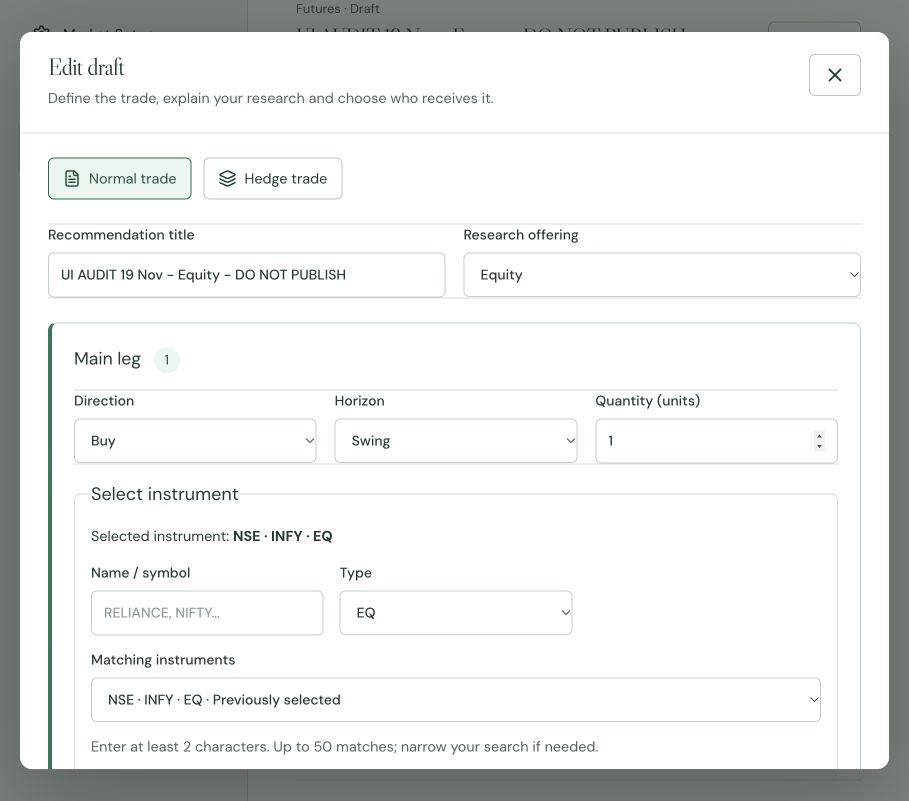
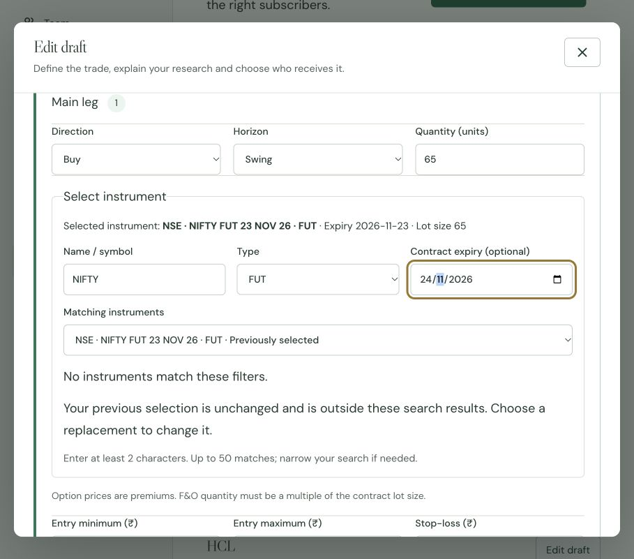
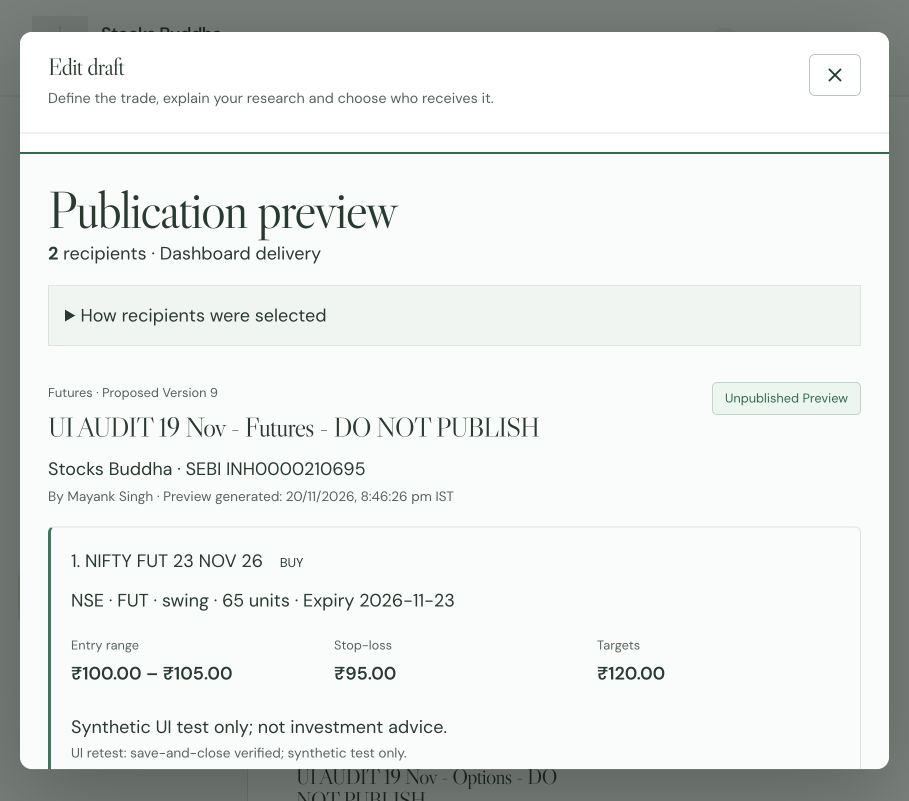
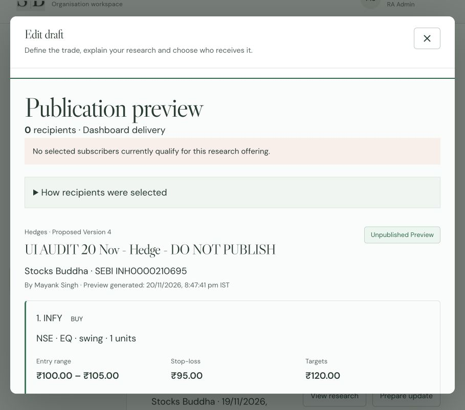

# Recommendation repairs and retest

Completed 20 November 2026 against the logged-in local RA Admin UI. All four repair phases are complete. This report supersedes the defects in the original baseline audit while preserving its evidence.

## Findings after repair

| Area                   | Result                                                                                                                                                                        | Evidence                                        |
| ---------------------- | ----------------------------------------------------------------------------------------------------------------------------------------------------------------------------- | ----------------------------------------------- |
| Hedge entry            | Fixed. Both controls create two legs and preserve compatible instruments. Returning to normal retains the compatible first leg.                                               | Live UI and component tests; retest-02          |
| Unsaved edits          | Fixed for Close, Cancel and Escape. Keep editing retains edits; Save and close persisted a note verified after reopening. Failed saves keep the editor open.                  | Live UI and component tests                     |
| Error feedback         | Fixed. Invalid buy stop-loss produced a readable leg/field error beside actions, focused and visible; correction cleared stale feedback.                                      | retest-03                                       |
| Saved instruments      | Fixed. Equity and derivative details resolve on reopening; Futures quantity stayed 65. Owner-authorized lookup can identify expired catalogue instruments.                    | Live UI and backend/picker tests; retest-01     |
| Expiry filters         | Fixed explanation. A 24 November search retained the selected 23 November contract with explicit no-match and preserved-selection text. Equity has no contract-expiry filter. | retest-05                                       |
| Empty groups           | Fixed. Unavailable group mode is disabled and explains how to create a group.                                                                                                 | Component test; live tenant already has a group |
| Preview metadata       | Fixed. Unpublished preview, Proposed version and Preview generated labels.                                                                                                    | retest-04 and retest-10                         |
| Labels/guidance        | Fixed. Edit draft heading, friendly field names, no F&O guidance for Equity.                                                                                                  | Live UI and component tests                     |
| Panel navigation       | Fixed. Groups and published report scroll/focus into view.                                                                                                                    | retest-08 and retest-09                         |
| Status badge           | Fixed at audited desktop width; Active stays on one line. Published version/time remain unchanged.                                                                            | retest-09                                       |
| Recipient explanations | Added aggregate candidate/exclusion counts without changing eligibility rules.                                                                                                | Live UI and backend tests                       |

Screenshots named `retest-01` through `retest-10` are alongside this report. Error feedback uses a focused summary with leg/field labels; per-input inline error annotations were not added. Browser unload protection is implemented, but an actual navigation warning was not exercised.

## Recipient and validation checks

| Test                                       | Observed result                                                                    |
| ------------------------------------------ | ---------------------------------------------------------------------------------- |
| Equity, all eligible                       | 0 recipients; two active subscribers excluded by subscription/offering eligibility |
| Futures, Gold                              | 2 recipients                                                                       |
| Futures, Silver                            | 0 recipients; two excluded by selected plan                                        |
| Futures, one-investor audit group          | 1 recipient                                                                        |
| Mixed Equity/PE hedge, same group          | 0 recipients; group membership does not grant hedge access                         |
| Futures quantity 1 vs lot size 65          | Preview blocked; restored to 65                                                    |
| Validity after 23 November contract expiry | Preview blocked; restored to 21 November                                           |
| Mixed hedge attachment                     | Existing attached document retained on reopening                                   |

Local mappings remain Silver = Equity, Gold = Futures/Options, Platinum = all four current offerings. Counts depend on eligible subscriptions and KYC; configuring a plan alone does not create eligible investors. Positive Silver/Platinum delivery was not demonstrated with this local audience.

Saving does not deliver research. Preview saves the complete draft and evaluates the audience and publication blockers. Publication recomputes checks before freezing recipients. Group and plan targeting narrow the eligible audience. Published updates retain the original audience. Exclusion diagnostics count the first failing check for each candidate, not every possible reason.

## Automated verification

47 focused tests passed, with no failures or skips:

```sh
TSX_TSCONFIG_PATH=tsconfig.base.json node --import tsx --test --test-timeout=15000 \
  frontend/tests/components/instrument-picker.test.tsx \
  frontend/tests/components/market.test.tsx \
  frontend/tests/components/recommendations.test.tsx \
  backend/tests/market.test.ts backend/tests/market-routes.test.ts \
  backend/tests/research.test.ts backend/tests/research-routes.test.ts
```

`npm run typecheck`, targeted ESLint, formatting checks and `git diff --check` passed. This is focused change verification, not the full precommit coverage gate. No commit was requested or made.

## State and limits

Existing labelled Equity, Futures and Hedge audit drafts were used. Futures retains quantity 65, the one-investor group and a synthetic save-and-close verification note. The Options report was inspected read-only; it was already published before this repair retest. No Publish, update-publication, withdrawal or closure action was submitted. Personal trading declarations were not changed.

Actual delivery/read/download through an investor login remains unverified. New uploads, full Hindi/mobile/accessibility coverage and positive Silver/Platinum delivery were not exercised. Backend routing tests do not substitute for these live checks. No remaining failure was observed in the repaired flows tested above.

## Representative evidence








